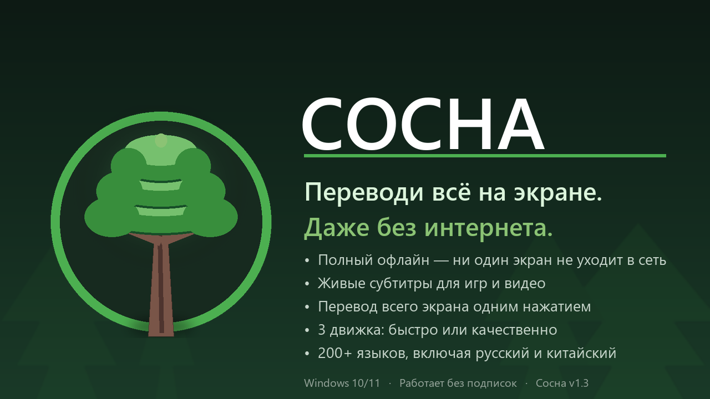

<p align="center">
  
</p>

<h1 align="center">🌲 Сосна</h1>

<p align="center">
  <b>Переводи всё на экране. Даже без интернета.</b><br>
  Выдели фрагмент — получи перевод. Всё считается локально на твоём ПК.
</p>

<p align="center">
  [GitHub release](https://img.shields.io/badge/версия-1.3.10-green)
  [Windows 10/11](https://img.shields.io/badge/Windows-10%20%7C%2011-blue)
  [Offline first](https://img.shields.io/badge/офлайн-100%25-brightgreen)
</p>

---

## Зачем

Экранные переводчики обычно шлют скриншоты в облако и просят подписку.
**Сосна** работает наоборот: распознавание — Windows OCR, перевод — нейросети
NLLB-200 (Meta) и Opus-MT через [CTranslate2] прямо на процессоре.
Интернет нужен только чтобы обновить базы — и то по желанию.

## Возможности

| | |
|---|---|
| 🎯 **Фрагмент** | выдели область мышью — перевод рядом с ней |
| 🖥 **Весь экран** | заморозка кадра + плашки переводов на месте текста |
| 📺 **Живые субтитры** | выдели область субтитров — фразы переводятся сами, по контексту |
| 🔁 **Повтор** | перевести ту же область ещё раз — без выделения |
| ✏️ **Исправление OCR** | нейросеть распознала криво? поправь текст руками и переведи заново |
| 📖 **Глоссарий** | свои термины применяются к любому переводу |
| 🕘 **История** | 200 последних переводов с поиском и копированием |
| 🎨 **Темы** | «Коми» (градиент флага Республики Коми), светлая, тёмная |

Хоткеи работают **в играх**: двойная схема (RegisterHotKey как у NVIDIA +
низкоуровневый резерв), зажатый WASD им не мешает.

## Три движка на выбор

| Движок | Скорость | Качество | Размер |
|---|---|---|---|
| ⚡ Opus-MT | мгновенно | среднее | ~0.3 ГБ |
| 🌲 NLLB-600M | ~1 с | хорошее | ~1 ГБ |
| 🏆 NLLB-1.3B | ~2 с | отличное | ~2 ГБ |

Все три входят в установщик — переключение на лету, без скачиваний.

## Установка

1. Скачай **[Sosna-Setup-1.3.10.exe](https://github.com/bpneket-noob/Sosna/releases/latest)** со страницы Releases
2. Запусти — права администратора не нужны, установка в профиль пользователя
3. Сосна сама появится в трее 🌲 и добавится в автозапуск

> Windows SmartScreen предупредит о неизвестном издателе — это нормально
> для сборки без платной подписи: «Подробнее» → «Выполнить в любом случае».

**Требования:** Windows 10/11 x64, ~3.5 ГБ на диске, 4+ ГБ ОЗУ (для NLLB-1.3B лучше 8+).

## Горячие клавиши

| Клавиши | Действие |
|---|---|
| **Ctrl+Alt+T** | перевести фрагмент |
| **Ctrl+Alt+F** | перевести весь экран |
| **Ctrl+Alt+L** | живые субтитры |
| **Ctrl+Alt+R** | повторить последний перевод |

Все комбинации и поведение меняются в трее → **Настройки**.

## Как это устроено

```
main.py ── очередь UI/хоткеев ── трей, окна (tkinter)
   │
   ├─ ocr.py          Windows OCR (WinRT), автоязык, фильтры мусора
   ├─ translate.py    CTranslate2: NLLB/Opus-MT, умный таймер памяти
   ├─ live.py         живые субтитры: сегментация фраз, commit-on-replace
   ├─ hotkeys_win.py  RegisterHotKey-диспетчер (метод NVIDIA)
   ├─ ui_kit.py       тема «Коми», градиенты, тени, WCAG AA
   └─ updater.py      обновление баз с HuggingFace (докачка, атомарная замена)
```

Данные пользователя — в `%APPDATA%\Sosna` (переживают переустановку),
логи — там же, `logs\sosna.log`.

## Лицензия

[MIT](LICENSE). Модели NLLB-200 (Meta) и Opus-MT распространяются на условиях
своих лицензий HuggingFace.

---

💚 Понравилось? Расскажи друзьям или
[поддержи автора](https://www.donationalerts.com/r/unclenikita).
